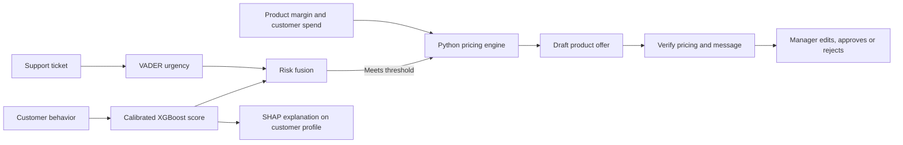

# RetainIQ

**An explainable customer retention workspace for e-commerce teams**

A manager can open a support ticket, inspect the customer's churn score, see which behaviors contributed to it, and review an offer that fits the product's margin. The local app uses the ChurnGuardAI name.

[Run locally](#run-locally) · [Model results](#what-the-model-achieved) · [Offer economics](#how-an-offer-is-priced) · [Verification](#verification)

## From a customer signal to a decision



| Workspace | What a manager can do |
| --- | --- |
| Landing and sign-in | Explore the product walkthrough and sign in with a manager session. |
| Dashboard | See current customer risk, run a scan, follow agent activity, and open pending offers. |
| Customers and profiles | Search, filter, sort, export the current page, and inspect SHAP factors, purchase summaries, tickets, and offers. |
| Support tickets | Simulate a conversation for a selected product and inspect sentiment, urgency, and the agent's reply. |
| Approval inbox | Review the linked product, margin, discount ceiling, proposed discount, and calculation before recording a decision. |
| Settings | Adjust intervention thresholds, business discount limits, scan schedules, ticket monitoring, and automatic drafting. |

## Reading the dashboard

**Customer churn risk distribution** answers “How many customers fall into each score range today?” The API groups valid stored scores from 0 to 100 into five bands. Each customer contributes once. The final band includes 100. Each bar shows its share of all scored customers, with the exact count alongside it.

In the verified local snapshot, 2,612 of 4,850 customers scored below 20 (53.9%), and 540 scored at least 60 (11.1%). The chart recalculates from the database when loaded or refreshed after a scan.

The earlier rolling chart counted a customer as retained when their latest order fell inside the window or a positive outcome was recorded. It classified inactive customers using their current risk score. Overlapping windows smoothed both curves, and the red line could include the same customer repeatedly. The dashboard's separate 30-day retention card still uses that operational estimate.

## What the model achieved

Training used 4,850 synthetic customer records with eight behavioral features covering purchase recency, order count, spend, complaints, satisfaction, tenure, returns, and discount use. The training script uses a stratified 60/20/20 split, oversamples the training split with SMOTE, calibrates probabilities on validation data, and evaluates each candidate on the held-out test set.

| Model | Test ROC AUC ↑ | Average precision ↑ | Brier score ↓ | Precision | Recall |
| --- | ---: | ---: | ---: | ---: | ---: |
| Logistic regression | **0.8150** | **0.6818** | **0.1341** | 81.00% | 32.27% |
| Random forest | 0.7916 | 0.6227 | 0.1453 | 78.12% | 29.88% |
| XGBoost (used by the app) | 0.8012 | 0.6627 | 0.1391 | **82.83%** | **32.67%** |

Logistic regression ranked churn cases best overall in this evaluation. At the default 0.60 cutoff, about 83 of every 100 XGBoost alerts corresponded to a churn label, but the model flagged only about one-third of all labeled churn cases. SHAP factors help a manager understand which inputs influenced an individual model score.

<details>
<summary>View the XGBoost calibration plot</summary>

The diagonal represents agreement between predicted probabilities and observed synthetic churn frequencies. Each point summarizes a group of test predictions.


</details>

[Saved evaluation metrics](backend/models/metrics.json) · [Training and evaluation code](backend/app/ml/train_churn_model.py)

## How an offer is priced

With a support ticket, the default policy combines 70% behavioral score and 30% ticket urgency. A proactive scan uses the behavioral score alone. Below the configured intervention threshold, the pipeline skips the draft.

For an eligible customer, Python caps the discount at the lowest of the manager's limit, 25%, and half the product's unrounded gross margin percentage. It rounds the ceiling down to a whole percent, with a lower bound of zero. The discount scales from the smaller of 5% and that ceiling according to fused risk and a lifetime-spend tier. The verifier checks the draft, and approval checks the live product and business limits again.

| Tested scenario | Gross margin | Product ceiling | Calculated discount |
| --- | ---: | ---: | ---: |
| Wireless ANC Earbuds, risk 89 | 18% | 9% | **8%** |
| Classic Fleece Hoodie, risk 89 | 60% | 25% | **20%** |
| Classic Fleece Hoodie, risk 100 | 60% | 25% | **25%** |

These tests hold customer spend at 2,000, the risk threshold at 60, and the manager limit at 25%. That isolates how product margin and risk affect the decision. The allocated discount is a deterministic policy choice. Measuring its effect on repeat purchases or profit would require observed outcomes and a comparison group.

Optional Gemini generation supplies apology wording. Python supplies the product, amount, and coupon reference. Local operation uses built-in text when live generation is disabled. Approval persists a manager's decision in SQLite. Email delivery and checkout redemption require external integrations.

[Pricing implementation](backend/app/services/pricing_engine.py) · [Pricing and approval tests](backend/tests/test_product_pricing.py)

## Run locally

The included launchers target Windows with PowerShell. Install Python 3.11–3.13 and Node.js 20.9 or later. From the repository root, run the following once.

```powershell
cd backend
python -m venv .venv
.\.venv\Scripts\python.exe -m pip install -r requirements-runtime.txt
cd ../frontend
npm ci
cd ..
.\run_churnguardai.bat
```

Open the [local app](http://127.0.0.1:3000) and choose **Use local demo credentials** on the sign-in page. The launcher starts Next.js and FastAPI, creates a working copy of the sample database, and applies additive migrations. Use `stop_churnguardai.bat` to stop the services. Setup options and account configuration are in [the local guide](LOCAL_SETUP.md).

## Verification

```powershell
cd backend
.\.venv\Scripts\python.exe -m pytest tests -q
cd ../frontend
npm run build
```

The backend suite uses a disposable database. It exercises authentication, dashboard counts, scoring, search, ticket processing, offer approval, pricing boundaries, and migration safety. The frontend production build checks TypeScript and builds all application routes. Live Gemini responses are mocked in the pricing tests.
